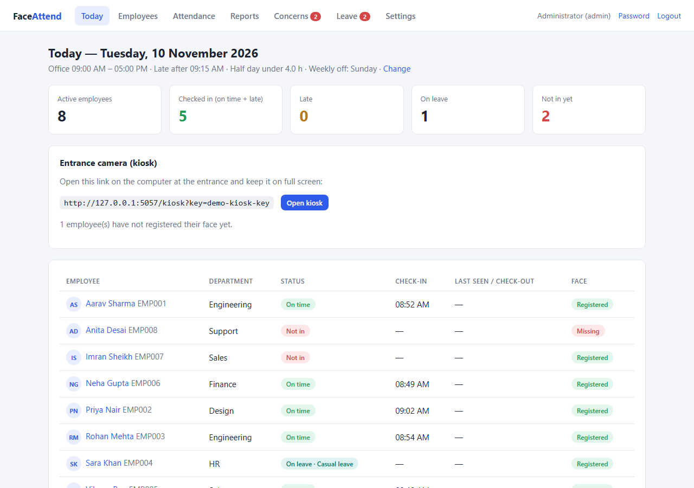
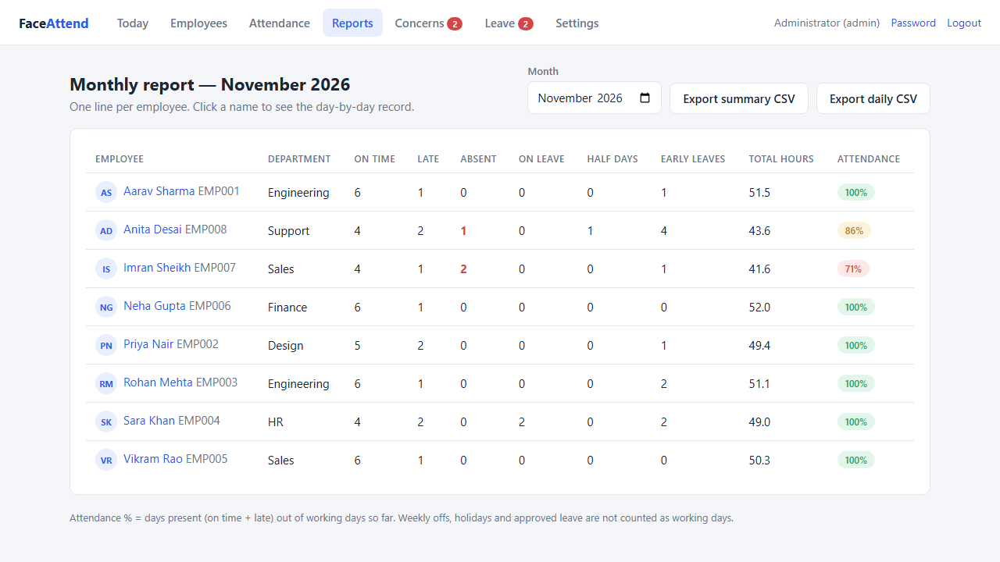
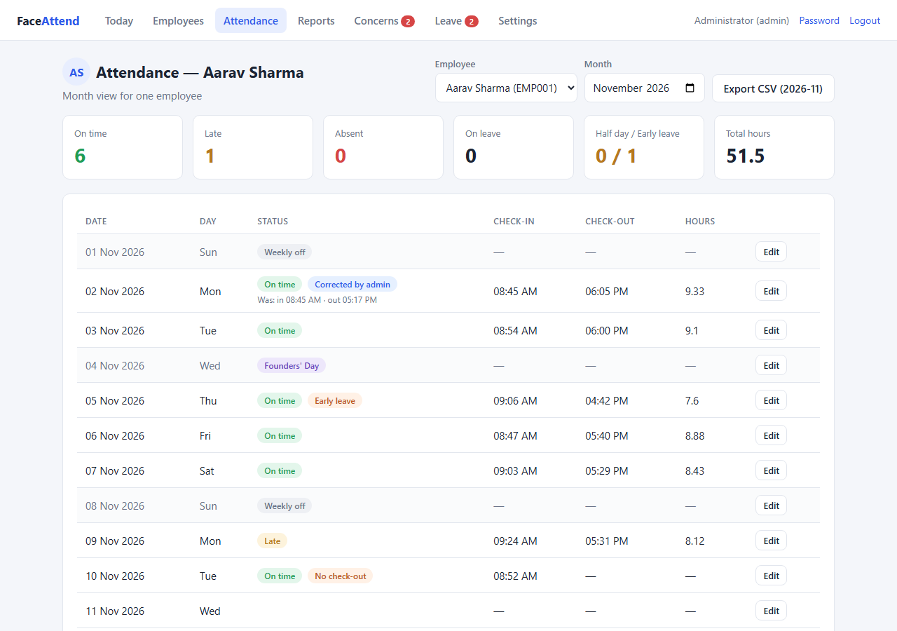
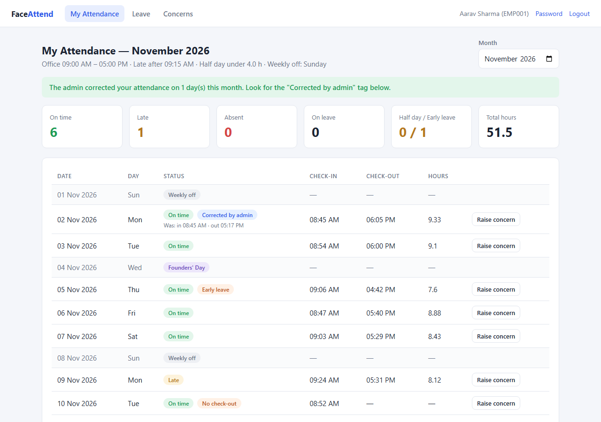
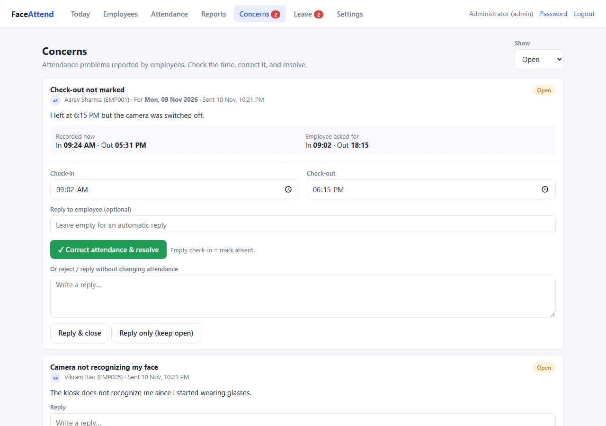
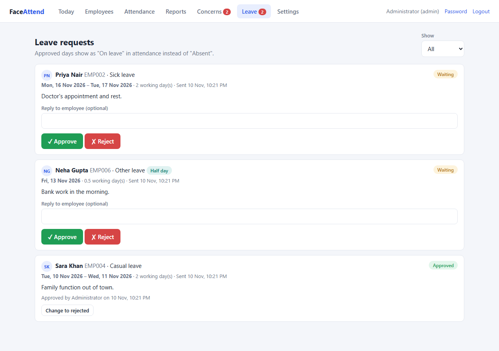
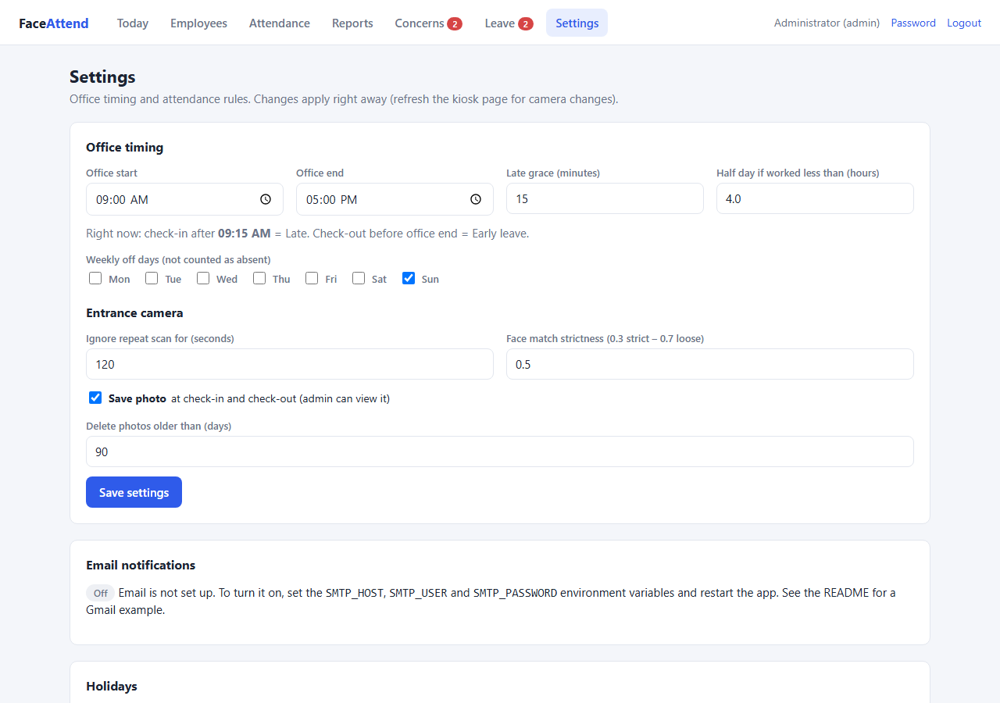
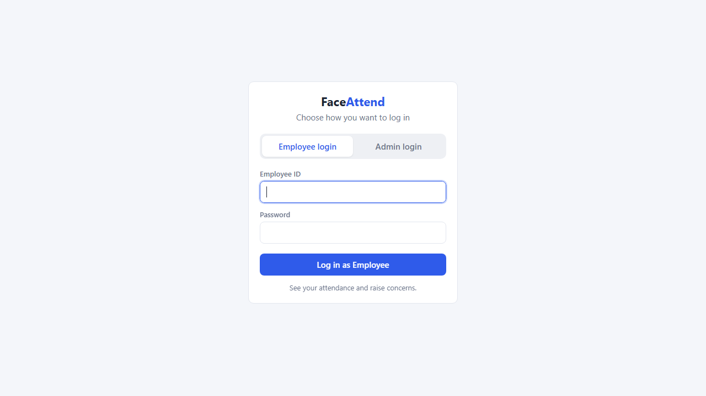

<div align="center">

# Face Attendance System

**Real-time face recognition attendance for offices: walk past the camera and your attendance is marked.**


</div>

---

## Overview

A camera at the entrance recognizes employees and records their attendance with a timestamp.
The first scan of the day is the **check-in** and later scans update the **check-out**.

Face recognition runs **in the browser** with [face-api.js](https://github.com/vladmandic/face-api), so camera images are not sent to the server for matching. Faces are stored as descriptors (lists of numbers). Check-in / check-out photos are saved only if snapshots are turned on in Settings.

## Screenshots

All screenshots use made-up demo data.

| Admin: today | Admin: monthly report |
|---|---|
|  |  |

| Admin: one employee's month | Employee portal |
|---|---|
|  |  |

| Concerns | Leave requests |
|---|---|
|  |  |

| Settings | Login |
|---|---|
|  |  |

## Features

| | |
|---|---|
| 📷 **Kiosk mode** | Full-screen entrance page that checks people in and out automatically |
| 🧑‍💼 **Admin panel** | Manage employees (with search), register faces, edit attendance, export CSV |
| 📊 **Monthly report** | One line per employee: on time, late, absent, leave, hours and attendance %, with CSV export for payroll |
| 🙋 **Employee portal** | Monthly attendance view, raise concerns, apply for leave |
| 📝 **Concerns** | Employees report a wrong time; admin fixes it in one click |
| 🌴 **Leave management** | Full-day or half-day leave requests with approve / reject; approved days show as *On leave* |
| ✉️ **Email notifications** | Employees get an email when their leave is decided or their concern is answered |
| 🧑 **Profile photos** | Optional employee photo shown next to their name in the admin panel |
| ⚙️ **Office rules** | Office hours, late grace, half-day hours, weekly offs, holidays |
| 🖼️ **Snapshots** | Optional photo at check-in / check-out with automatic cleanup |
| 🔒 **Security** | CSRF protection, hashed passwords, login lockout after failed attempts, security headers, deactivated accounts are logged out at once |

### Attendance rules

| Status | When |
|---|---|
| **Late** | Check-in after office start + grace minutes |
| **Early leave** | Check-out before office end |
| **Half day** | Worked less than `half_day_hours` |
| **No check-out** | Day is over and there is no check-out |
| **On leave** | Approved leave for that day (a half-day leave counts as 0.5 days) |
| **Half-day leave** | Approved half-day leave and the employee also came in; early leave is not flagged |
| **Absent** | Working day with no scan, no leave and not a holiday |

## Tech Stack

- **Backend:** Python, Flask, Flask-SQLAlchemy, Flask-Login
- **Database:** SQLite
- **Face recognition:** face-api.js (TinyFaceDetector, 68-point landmarks, face recognition model)
- **Frontend:** HTML, CSS, vanilla JavaScript

## Getting Started

### Prerequisites

- Python 3.10 or newer
- A webcam
- A modern browser (Chrome, Edge or Firefox)

### Installation

```bash
git clone https://github.com/musaddiq-vd/face-attendance-system.git
cd face-attendance-system

python -m venv venv
venv\Scripts\activate          # Windows
# source venv/bin/activate     # macOS / Linux

pip install -r requirements.txt
python download_models.py      # downloads face-api.js and model files (skip if already present)
python seed.py                 # creates the admin account
```

### Run

```bash
python app.py
```

Open **http://localhost:5000** in your browser.

> [!NOTE]
> Browsers only allow camera access on `localhost` or over `https`. To use the kiosk from another computer, serve the app over HTTPS.

### First login

`python seed.py` creates the admin account with ID `admin` and a **random password**, printed once in the terminal.
To choose the password yourself, set `ADMIN_PASSWORD` before running it:

```powershell
$env:ADMIN_PASSWORD = "your-strong-password"
python seed.py
```

> [!WARNING]
> Save the printed password and change it after your first login (**Password**, top right).

## Usage

1. **Add employees:** log in as admin → **Employees** → add an employee (ID + password).
2. **Register faces:** after adding, capture 5 face samples on the registration page.
   You can do this later from **Employees → Manage → Register face**.
3. **Start the kiosk:** copy the kiosk link from the admin **Today** page
   (`http://localhost:5000/kiosk?key=...`), open it on the entrance computer and press **F11** for full screen.
4. **Employees** log in to see their monthly record, raise concerns and apply for leave
   (tick **Half day** for a half-day leave).
5. **Admin** reviews concerns and leave requests, edits attendance and exports CSV reports.
   **Reports** shows the monthly totals for every employee on one page.
6. **Profile photo (optional):** **Employees → Manage → Profile photo** → upload a JPG, PNG or WebP (max 3 MB).

## Configuration

Set these as environment variables (all optional):

| Variable | Default | Description |
|---|---|---|
| `KIOSK_KEY` | random, saved in `.kiosk_key` | Secret key in the kiosk URL |
| `SECRET_KEY` | random, saved in `.secret_key` | Signs login sessions |
| `ADMIN_ID` / `ADMIN_PASSWORD` | `admin` / random | Used once by `seed.py` to create the admin |
| `DATABASE_URL` | `sqlite:///attendance.db` | Database connection string |
| `SNAPSHOT_DIR` | `snapshots/` | Folder for check-in / check-out photos |
| `PROFILE_DIR` | `profile_photos/` | Folder for employee profile photos |
| `HOST` | `127.0.0.1` | Use `0.0.0.0` to allow other computers on the network |
| `PORT` | `5000` | Server port |
| `FLASK_DEBUG` | off | Set to `1` only during development |
| `SESSION_COOKIE_SECURE` | off | Set to `1` when the app is served over HTTPS |

Office rules (hours, grace time, holidays, photo settings, face match strictness) are changed from **Admin → Settings**.

### Email notifications (optional)

Emails go to the address saved on each employee's profile. Email is off until `SMTP_HOST` is set.

| Variable | Example | Description |
|---|---|---|
| `SMTP_HOST` | `smtp.gmail.com` | Mail server |
| `SMTP_PORT` | `587` | `587` for STARTTLS, `465` for SSL |
| `SMTP_USER` | `hr@yourcompany.com` | Login for the mail server |
| `SMTP_PASSWORD` | `abcd efgh ijkl mnop` | Password (for Gmail, an [App Password](https://support.google.com/accounts/answer/185833)) |
| `SMTP_FROM` | `hr@yourcompany.com` | Sender address (defaults to `SMTP_USER`) |
| `SMTP_USE_SSL` | `1` | Set to `1` when using port `465` |

Example on Windows (PowerShell), then start the app in the same window:

```powershell
$env:SMTP_HOST = "smtp.gmail.com"
$env:SMTP_USER = "hr@yourcompany.com"
$env:SMTP_PASSWORD = "your-app-password"
python app.py
```

Check it from **Admin → Settings → Email notifications → Send test email**.

> [!IMPORTANT]
> Never put the SMTP password in the code or commit it to GitHub. Keep it in environment variables.

## Project Structure

```
face-attendance-system/
├── app.py               # Flask routes and attendance logic
├── models.py            # Database models
├── config.py            # App config and default office rules
├── seed.py              # Creates the first admin account
├── download_models.py   # Downloads face-api.js and model files
├── requirements.txt
├── static/
│   ├── css/             # Styles
│   ├── js/              # Kiosk, face registration and face helper scripts
│   ├── models/          # face-api.js model weights
│   └── vendor/          # face-api.js library
├── templates/           # Jinja2 HTML pages
├── tests/               # Unit tests
├── docs/screenshots/    # Images used in this README
├── snapshots/           # Check-in / check-out photos (created at runtime, not in git)
└── profile_photos/      # Employee profile photos (created at runtime, not in git)
```

## Running Tests

```bash
python -m unittest discover tests -v
```

Tests use a temporary database, so your real data is not touched.

## Limitations

- There is no liveness (anti-spoofing) check, so a good photo of a face may be accepted. Keep
  **Save photo** turned on in Settings so the admin can review check-in photos.
- One attendance record is kept per calendar day, so shifts that cross midnight are not supported.
- `python app.py` starts Flask's built-in server, which is fine for one office on a local network.
  For anything bigger, run the app with a production WSGI server.
- Login lockout and caches live in memory, so run a single server process.

## Privacy

The database (`attendance.db`), snapshots, profile photos, `.secret_key`, `.kiosk_key` and `.env` are listed in `.gitignore` and are never uploaded. No passwords or keys are written in the code; they come from environment variables or are generated locally. Face data is personal data. Get employee consent and follow the privacy laws that apply where you use this system.

## License

This project is licensed under the [MIT License](LICENSE).
