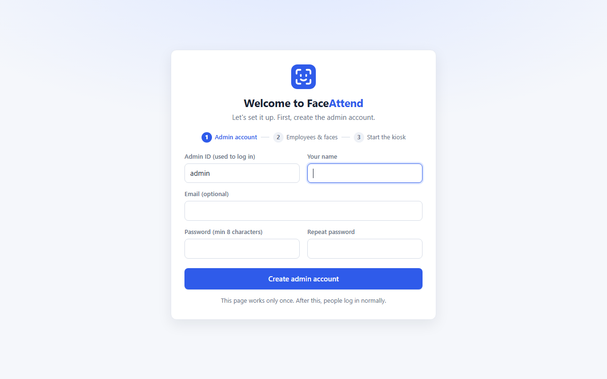
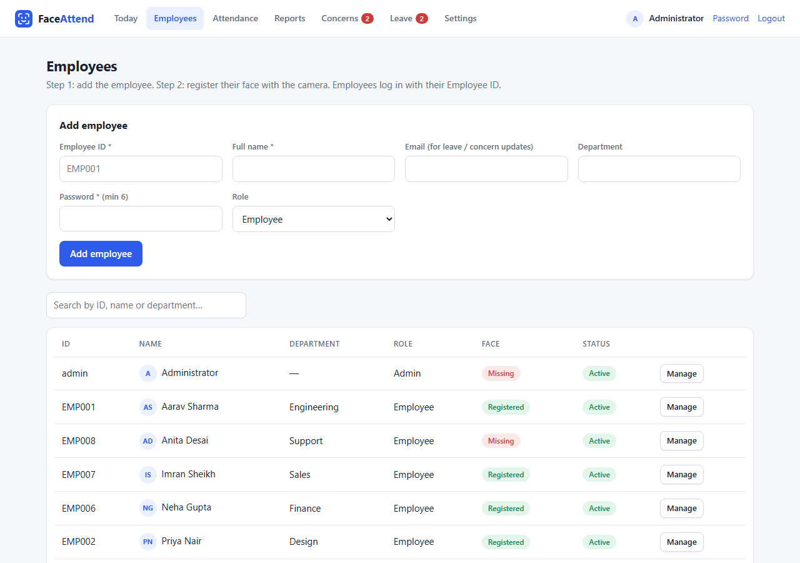

<div align="center">

# Face Attendance System

**Real-time face recognition attendance for offices: walk past the camera and your attendance is marked.**


</div>

---

## Overview

A camera at the entrance recognizes employees and records their attendance with a timestamp.
The first scan of the day is the **check-in** and later scans update the **check-out**.

Face recognition runs **in the browser** with [face-api.js](https://github.com/vladmandic/face-api), so camera images are not sent to the server for matching. Faces are stored as descriptors (lists of numbers). Check-in / check-out photos are saved only if snapshots are turned on in Settings.

## Screenshots

All screenshots use made-up demo data.

| First-run setup | Admin: today |
|---|---|
|  |  |

| Admin: monthly report | Admin: one employee's month |
|---|---|
|  |  |

| Employees | Employee portal |
|---|---|
|  |  |

| Concerns | Leave requests |
|---|---|
|  |  |

| Settings | Login |
|---|---|
|  |  |

## Features

| | |
|---|---|
| 📷 **Kiosk mode** | Full-screen entrance page that checks people in and out automatically, with sound, a live count and an online indicator for the admin |
| 🚀 **Guided setup** | First-run page creates the admin account; a *Getting started* checklist walks through the rest |
| 🧑‍💼 **Admin panel** | Manage employees (with search), register faces step by step, edit attendance, export CSV |
| 📊 **Monthly report** | One line per employee: on time, late, absent, leave, hours and attendance %, with CSV export for payroll |
| 🙋 **Employee portal** | Monthly attendance view, raise concerns, apply for leave |
| 📝 **Concerns** | Employees report a wrong time; admin fixes it in one click |
| 🌴 **Leave management** | Full-day or half-day leave requests with approve / reject; approved days show as *On leave* |
| ✉️ **Email notifications** | Employees get an email when their leave is decided or their concern is answered |
| 🧑 **Profile photos** | Optional employee photo shown next to their name in the admin panel |
| ⚙️ **Office rules** | Office hours, late grace, half-day hours, weekly offs, holidays |
| 🖼️ **Snapshots** | Optional photo at check-in / check-out with automatic cleanup |
| 🔒 **Security** | CSRF protection, hashed passwords, login lockout, security headers, sessions that expire, deactivated accounts are logged out at once |
| 🛠️ **Operations** | Production web server, `.env` config, Docker image, health check, database backup command, CI tests |

### Attendance rules

| Status | When |
|---|---|
| **Late** | Check-in after office start + grace minutes |
| **Early leave** | Check-out before office end |
| **Half day** | Worked less than `half_day_hours` |
| **No check-out** | Day is over and there is no check-out |
| **On leave** | Approved leave for that day (a half-day leave counts as 0.5 days) |
| **Half-day leave** | Approved half-day leave and the employee also came in; early leave is not flagged |
| **Absent** | Working day with no scan, no leave and not a holiday |

## Tech Stack

- **Backend:** Python, Flask, Flask-SQLAlchemy, Flask-Login, served by Waitress
- **Database:** SQLite (WAL mode)
- **Face recognition:** face-api.js (TinyFaceDetector, 68-point landmarks, face recognition model)
- **Frontend:** HTML, CSS, vanilla JavaScript

## Quick Start

You need Python 3.10 or newer, a webcam, and Chrome, Edge or Firefox.

**Step 1. Get the code and install it**

```bash
git clone https://github.com/musaddiq-vd/face-attendance-system.git
cd face-attendance-system

python -m venv venv
venv\Scripts\activate          # Windows
# source venv/bin/activate     # macOS / Linux

pip install -r requirements.txt
```

**Step 2. Start the app**

```bash
python app.py
```

**Step 3. Create the admin account**

Open **http://localhost:5000** on the same computer. The first time, a set-up page asks for the admin ID, name and password.

**Step 4. Follow the *Getting started* checklist on the dashboard**

1. **Add your employees** (Employees → Add employee).
2. **Register every employee's face.** The page asks for 5 captures: straight, left, right, chin up, chin down.
3. **Set office hours, weekly off and holidays** (Settings).
4. **Open the kiosk at the entrance.** Copy the kiosk link from the dashboard, open it on the entrance computer and press **F11** for full screen.

That is all. Employees can now log in with their Employee ID to see their record, raise concerns and apply for leave.

> [!NOTE]
> Browsers only allow camera access on `localhost` or over `https`. To use the kiosk from another computer, serve the app over HTTPS (see [Deployment](#deployment)).

<details>
<summary>Other ways to create the admin account</summary>

- **From the terminal:** `python seed.py` creates the admin `admin` with a random password and prints it once.
- **From the environment:** set `ADMIN_PASSWORD` (and optionally `ADMIN_ID`) before starting the app. This is how the Docker setup does it.
- The set-up page only works from the server computer itself. Set `ALLOW_REMOTE_SETUP=1` to allow it from another computer.

</details>

## Daily Use

| Who | What |
|---|---|
| **Employees** | Look at the kiosk when arriving and leaving. Log in to see the month, raise a concern for a wrong time, or apply for leave (tick **Half day** for a half-day leave). |
| **Admin** | **Today** shows who is in, late, on leave or missing, and whether the kiosk is running. **Concerns** and **Leave** show requests waiting for an answer. **Attendance** edits any day. **Reports** gives the monthly totals and CSV files. |

Profile photos are optional: **Employees → Manage → Profile photo** (JPG, PNG or WebP, max 3 MB).

## Configuration

All settings are optional. Put them in a `.env` file (copy [`.env.example`](.env.example)) or set them as environment variables.

| Variable | Default | Description |
|---|---|---|
| `HOST` | `127.0.0.1` | Use `0.0.0.0` to allow other computers on the network |
| `PORT` | `5000` | Server port |
| `DATA_DIR` | project folder | Where the database, photos and generated keys are kept |
| `ADMIN_ID` / `ADMIN_PASSWORD` | not set | Creates the first admin at start-up instead of the set-up page |
| `ALLOW_REMOTE_SETUP` | off | Set to `1` to allow the set-up page from another computer |
| `KIOSK_KEY` | random, saved in `.kiosk_key` | Secret key in the kiosk URL |
| `SECRET_KEY` | random, saved in `.secret_key` | Signs login sessions |
| `DATABASE_URL` | `sqlite:///attendance.db` | Database connection string |
| `SNAPSHOT_DIR` | `snapshots/` | Folder for check-in / check-out photos |
| `PROFILE_DIR` | `profile_photos/` | Folder for employee profile photos |
| `BEHIND_PROXY` | off | Set to `1` behind an HTTPS reverse proxy |
| `SESSION_COOKIE_SECURE` | off | Set to `1` when the app is served over HTTPS |
| `FLASK_DEBUG` | off | Set to `1` only during development (auto-reload) |

Office rules (hours, grace time, holidays, photo settings, face match strictness) are changed from **Admin → Settings**.

### Email notifications (optional)

Emails go to the address saved on each employee's profile. Email is off until `SMTP_HOST` is set.

| Variable | Example | Description |
|---|---|---|
| `SMTP_HOST` | `smtp.gmail.com` | Mail server |
| `SMTP_PORT` | `587` | `587` for STARTTLS, `465` for SSL |
| `SMTP_USER` | `hr@yourcompany.com` | Login for the mail server |
| `SMTP_PASSWORD` | `abcd efgh ijkl mnop` | Password (for Gmail, an [App Password](https://support.google.com/accounts/answer/185833)) |
| `SMTP_FROM` | `hr@yourcompany.com` | Sender address (defaults to `SMTP_USER`) |
| `SMTP_USE_SSL` | `1` | Set to `1` when using port `465` |

Check it from **Admin → Settings → Email notifications → Send test email**.

> [!IMPORTANT]
> Never put the SMTP password in the code or commit it to GitHub. Keep it in `.env` or environment variables.

## Deployment

`python app.py` runs the app with [Waitress](https://docs.pylonsproject.org/projects/waitress/), a production web server. Run **one** server process (login lockout and caches are kept in memory).

### On the office network with HTTPS

The kiosk camera needs `https://` when the page is not opened on `localhost`. The simplest way is a reverse proxy such as [Caddy](https://caddyserver.com/), which gets the certificate for you:

```bash
caddy reverse-proxy --from attendance.yourcompany.com --to localhost:5000
```

and in `.env`:

```
BEHIND_PROXY=1
SESSION_COOKIE_SECURE=1
```

### With Docker

```bash
echo ADMIN_PASSWORD=choose-a-long-password > .env
docker compose up -d
```

The database, photos and keys are stored in the `attendance-data` volume. The container reports its health through `/healthz`.

### Backups

```bash
flask --app app backup-db
```

This writes a safe copy of the database to `backups/` inside the data folder, even while the app is running. Also copy the `snapshots/` and `profile_photos/` folders if you use them.

### Monitoring

- `GET /healthz` returns `{"status": "ok"}` when the app and database work.
- The log (standard output) records logins, failed logins, kiosk scans and attendance edits.
- The admin dashboard shows whether the kiosk page is running.

## Troubleshooting

| Problem | What to do |
|---|---|
| *Camera is blocked* on the kiosk | Allow the camera in the browser's address bar and reload. On another computer the page must be opened over `https://`. |
| *Face not recognized* | Register the face again in good light. If it still fails, raise **Face match strictness** a little in Settings (for example 0.55). |
| The wrong person is recognized | Lower **Face match strictness** (for example 0.45) and register both faces again. |
| *Kiosk link is no longer valid* | The kiosk key changed. Copy the new link from the admin dashboard. |
| Forgot the admin password | Another admin can set a new one from **Employees → Manage**. |
| Set-up page says it only works on the server | Open `http://localhost:5000` on the server computer, or set `ALLOW_REMOTE_SETUP=1`. |

## Project Structure

```
face-attendance-system/
├── app.py               # Flask routes and attendance logic
├── models.py            # Database models
├── config.py            # App config and default office rules
├── seed.py              # Creates the first admin from the terminal (optional)
├── download_models.py   # Downloads face-api.js and model files (already included)
├── requirements.txt
├── .env.example         # Template for local settings
├── Dockerfile, docker-compose.yml
├── static/
│   ├── css/             # Styles
│   ├── img/             # Logo
│   ├── js/              # Kiosk, face registration and face helper scripts
│   ├── models/          # face-api.js model weights
│   └── vendor/          # face-api.js library
├── templates/           # Jinja2 HTML pages
├── tests/               # Unit tests
├── docs/screenshots/    # Images used in this README
├── snapshots/           # Check-in / check-out photos (created at runtime, not in git)
└── profile_photos/      # Employee profile photos (created at runtime, not in git)
```

## Running Tests

```bash
python -m unittest discover tests -v
```

Tests use a temporary database, so your real data is not touched. They also run on GitHub for every push.

## Limitations

- There is no liveness (anti-spoofing) check, so a good photo of a face may be accepted. Keep
  **Save photo** turned on in Settings so the admin can review check-in photos.
- One attendance record is kept per calendar day, so shifts that cross midnight are not supported.
- Built for one office with one server process. Login lockout and caches live in memory.

## Privacy

The database (`attendance.db`), snapshots, profile photos, `.secret_key`, `.kiosk_key` and `.env` are listed in `.gitignore` and are never uploaded. No passwords or keys are written in the code; they come from environment variables or are generated locally. Face data is personal data. Get employee consent and follow the privacy laws that apply where you use this system.

## License

This project is licensed under the [MIT License](LICENSE).
